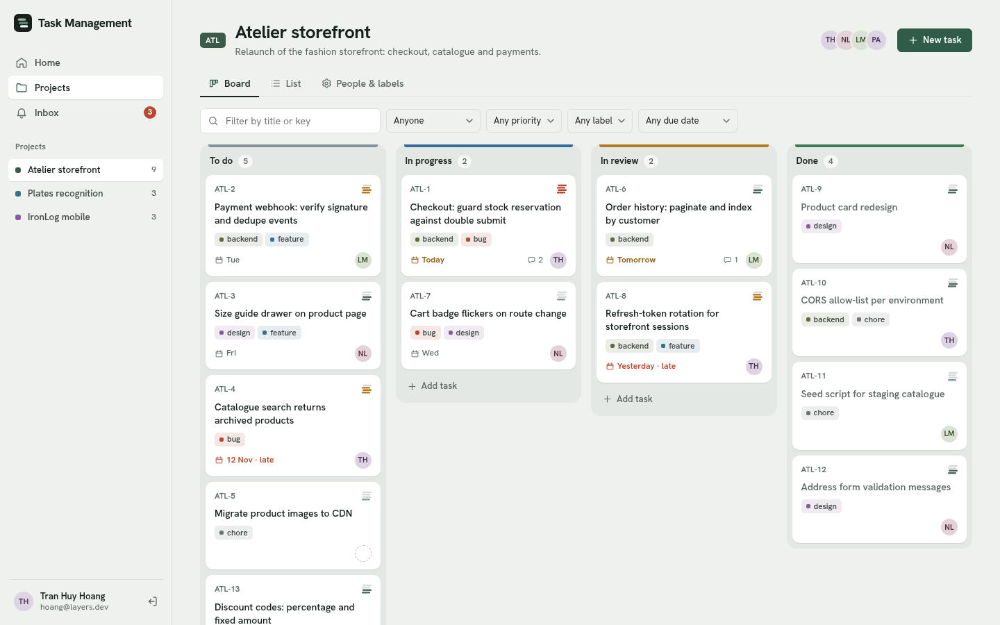

# Layers — Mini-Jira Agile Sprint Workspace & AI Copilot

**Layers** is a fast, keyboard-first **Agile Project & Sprint Management System ("Mini-Jira")** paired with a **Level 2 + Level 3 + Generative UI AI Sprint Copilot**. It combines Jira’s Agile rigor — **Epics, Sprints, Product Backlog, Fibonacci Story Points, Issue Keys (`LAY-104`), WIP Limits, and Burndown/Velocity Analytics** — with Linear-grade interaction speed and `.NET 10` Clean Architecture boundaries.



---

## Highlights

### 1. Mini-Jira Agile Workspace (`task-management-frontend`)
- **Jira Issue Hierarchy & Metadata**: Issue keys (`LAY-101`, `API-201`), distinct crisp SVG issue types (`Epic`, `Story`, `Task`, `Bug`, `Subtask`), Priority stack glyphs (`Urgent`, `High`, `Medium`, `Low`), Fibonacci **Story Points** (`1, 2, 3, 5, 8, 13`), **Epic Link badges**, **Sprint assignment**, Subtasks progress checklists, Logged vs Estimated hours, Comments, and Activity Audit Trail.
- **Active Sprint Kanban Board**:
  - Smooth pointer/touch/keyboard drag-and-drop powered by fractional rank indexing (`Rank.Between`).
  - **WIP Limit Column Indicators**: Highlights column headers in amber/crimson when active cards exceed team thresholds (e.g. `In Progress · 4 / 3 MAX`).
  - **Group-By Swimlanes**: Dynamically slice the board by `None`, `By Epic`, `By Assignee`, or `By Priority`.
  - **Multi-Facet Filter Bar**: Instant member avatar toggles, Epic selector, priority/type/label/due filters synced with URL query params.
- **Backlog & Sprint Planning View**:
  - Collapsible **Active Sprint**, **Planned Sprint**, and **Product Backlog** buckets with live `Todo / In Progress / Done` Story Point pills.
  - **Start Sprint** & **Complete Sprint** modals that automatically roll unfinished spillover issues into the next planned iteration.
- **2-Column Jira Issue Detail Drawer**:
  - Left main column with `Project / Epic / Key` breadcrumb, inline editable title & description, interactive **Subtasks Progress Bar & Checklist**, and **Comments / History Audit Log** tabs.
  - Right metadata rail with optimistic concurrency (`ETag` / `version`) conflict detection (`409 Conflict` resolution banner).
- **Sprint Burndown & Velocity Analytics**:
  - Pure-SVG **Sprint Burndown Chart** (Ideal guideline vs Remaining Story Points), **Team Velocity Bar Chart** across iterations, **Workload by Assignee**, and **Epic Progress Bars**.
- **Global `Cmd/Ctrl + K` Command Palette & Shortcuts**:
  - Jump directly to any issue key (`LAY-104`), switch views (`Board`, `Backlog`, `List`, `Analytics`, `Inbox`), press `C` to draft a new issue, press `Cmd/Ctrl + J` to dock the AI Copilot, toggle **Light Fog / Dark Graphite** themes (strictly zero purple clichés, full `tabular-nums`), and switch **English / Tiếng Việt**.

### 2. Layers AI Sprint Copilot (Level 2 Hybrid RAG + Level 3 Tool-Use + Generative UI)
Dockable right-hand engineering copilot (`src/components/ai-copilot/` + `POST /api/v1/ai/chat`):
- **Dual-Mode Intelligence**: Uses `VITE_GEMINI_API_KEY` / backend `GEMINI_API_KEY` when configured, with an always-available **Local Hybrid BM25 + Bilingual Facet & Agile Tool Engine** (English & Vietnamese) grounded in live workspace state.
- **5 Workspace Agent Tools**:
  1. `search_issues_hybrid(query, filters)` — BM25 lexical + structured facet extraction (*"find high priority bugs"* / *"tìm các lỗi ưu tiên cao chưa giao"*).
  2. `create_issue(...)` — Creates a real estimated issue directly in the active sprint or backlog.
  3. `transition_issue(issueKey, nextStatus)` — Moves `LAY-104` to `In Review` or `Done` with concurrency version increment.
  4. `decompose_epic_to_subtasks(issueKeyOrGoal)` — Breaks an Epic or feature goal into 5 estimated Stories/Subtasks with Story Points.
  5. `analyze_sprint_health(projectId)` — Computes sprint health score, WIP limit breaches, overloaded assignees, and spillover candidates.
- **3 Interactive Generative UI Cards inside Chat**:
  - **Interactive Jira Issue Cards** with an inline **Status Dropdown** that transitions the real board card immediately.
  - **Batch Subtask Proposal Card** with checkboxes, Story Point badges, and a 1-click **"Approve & Create Selected Issues"** button.
  - **Sprint Health & Bottleneck Diagnostic Card** with SVG health gauge, WIP alerts, and a 1-click **"Rebalance / Move Spillover to Backlog"** button.

---

## Clean Architecture Layout

```text
TaskManagement.Domain/          Entities, Enums (Epic/Story/Task/Bug/Subtask, Backlog..Done), Rank & RBAC rules
TaskManagement.Application/     Contracts (Tasks, Projects, Dashboard, AiCopilot), Validators, Service interfaces
TaskManagement.Infrastructure/  EF Core (SQLite & SQL Server), Migrations, Token service, AiCopilotService, Seeder
TaskManagement.API/             ASP.NET Core 10 Controllers (/api/v1/* including /api/v1/ai/chat), ProblemDetails
tests/TaskManagement.Tests/     xUnit Domain, Service, and HTTP integration tests
task-management-frontend/       React 19 + TypeScript + Vite SPA, Stateful Local Agile Engine, Vitest + Playwright
docs/                           FEATURES.md, DESIGN.md, API_REFERENCE.md, screenshots/
```

- **API Reference**: [`docs/API_REFERENCE.md`](docs/API_REFERENCE.md)
- **Feature Spec**: [`docs/FEATURES.md`](docs/FEATURES.md)
- **Design Notes**: [`docs/DESIGN.md`](docs/DESIGN.md)

---

## Quick Start

### Option A — Instant Standalone Frontend (Zero Backend / DB Setup Required)
When `VITE_API_URL` is unset, the frontend automatically boots its **Stateful Local Agile Engine** (`src/api/localEngine.ts`) persisted in `localStorage` with 3 rich Agile projects (`LAY`, `API`, `ATL`), active/planned sprints, epics, velocity history, and full CRUD + drag-and-drop.

```bash
cd task-management-frontend
npm install
npm run dev
```

Open `http://localhost:5173` and click **Enter Live Workspace (Demo Admin)** — no login required.

### Option B — Full-Stack `.NET 10` API + React Frontend
Requires **.NET 10 SDK** and **Node.js 20+**. Uses SQLite (`layers.db`) out of the box or SQL Server via `Database__Provider=SqlServer`.

```bash
# 1. Start ASP.NET Core 10 API on http://localhost:5080
cd TaskManagement.API
ASPNETCORE_ENVIRONMENT=Development dotnet run --urls http://localhost:5080

# 2. Start Vite frontend pointed at the .NET API
cd ../task-management-frontend
VITE_API_URL=http://localhost:5080/api/v1 npm run dev
```

Demo accounts seeded in Development:

| Email | Password | Workspace Role |
|---|---|---|
| `hoang@layers.dev` | `Layers2026` | Owner across `LAY`, `API`, and `ATL` |
| `linh@layers.dev` | `Layers2026` | Admin (`LAY`, `ATL`) |
| `minh@layers.dev` | `Layers2026` | Member (`LAY`, `API`, `ATL`) |
| `an@layers.dev` | `Layers2026` | Viewer (read-only verification) |

Optional AI LLM enrichment: set `VITE_GEMINI_API_KEY=<your-key>` (frontend) or `GEMINI_API_KEY=<your-key>` (`.NET` API).

---

## Testing & Verification

```bash
# Frontend unit & integration suite (Vitest + Testing Library)
cd task-management-frontend
npm test

# TypeScript strict check + production Vite bundle
npm run build

# Backend xUnit test suite (when .NET 10 SDK is installed)
dotnet test ../tests/TaskManagement.Tests
```
